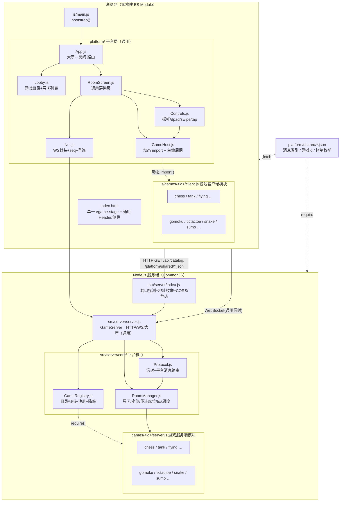
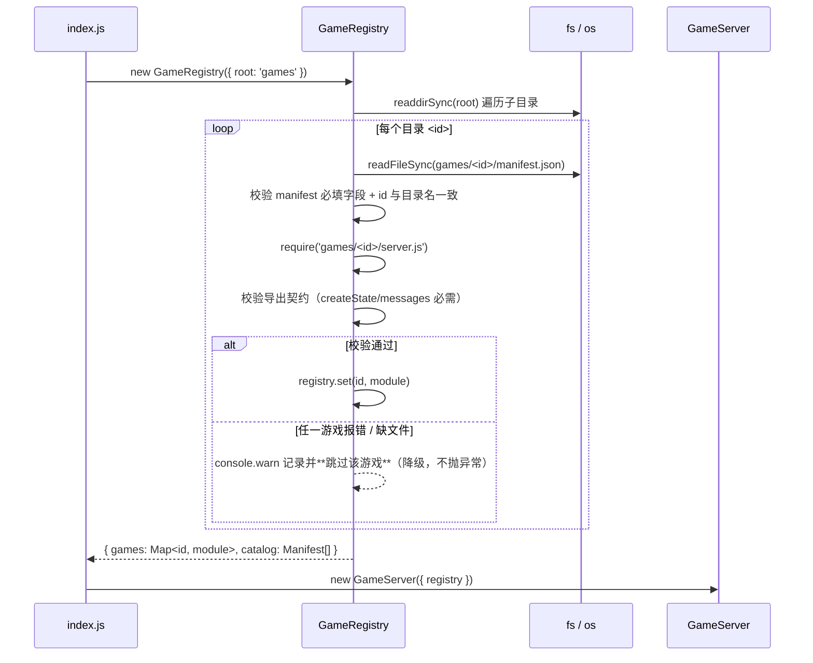
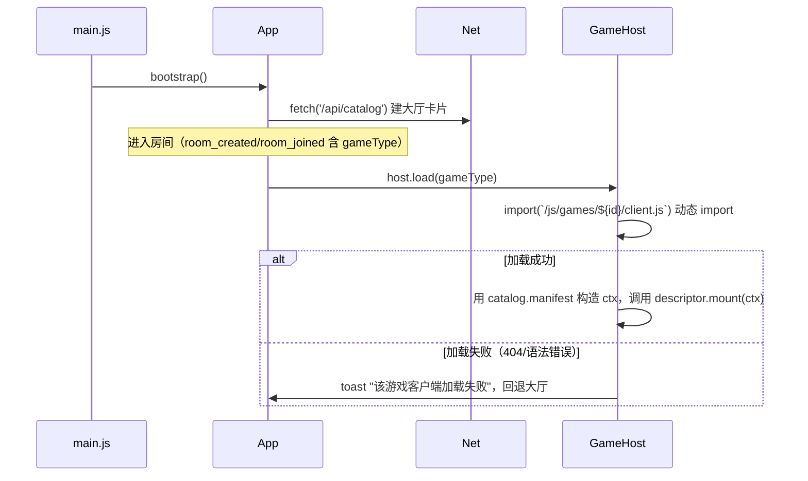
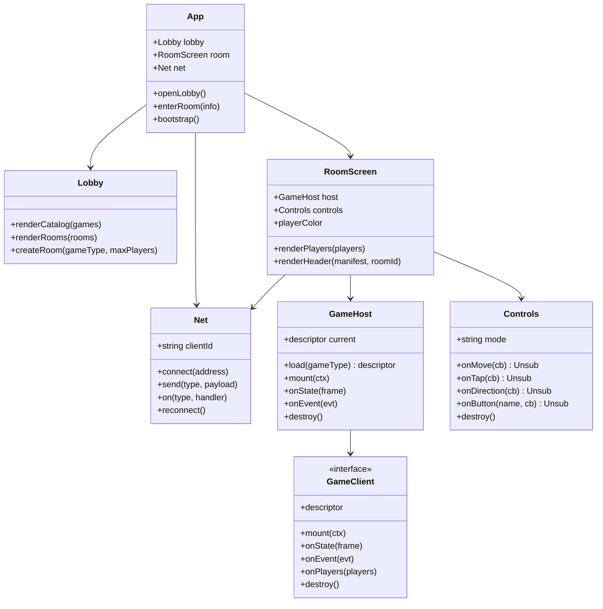
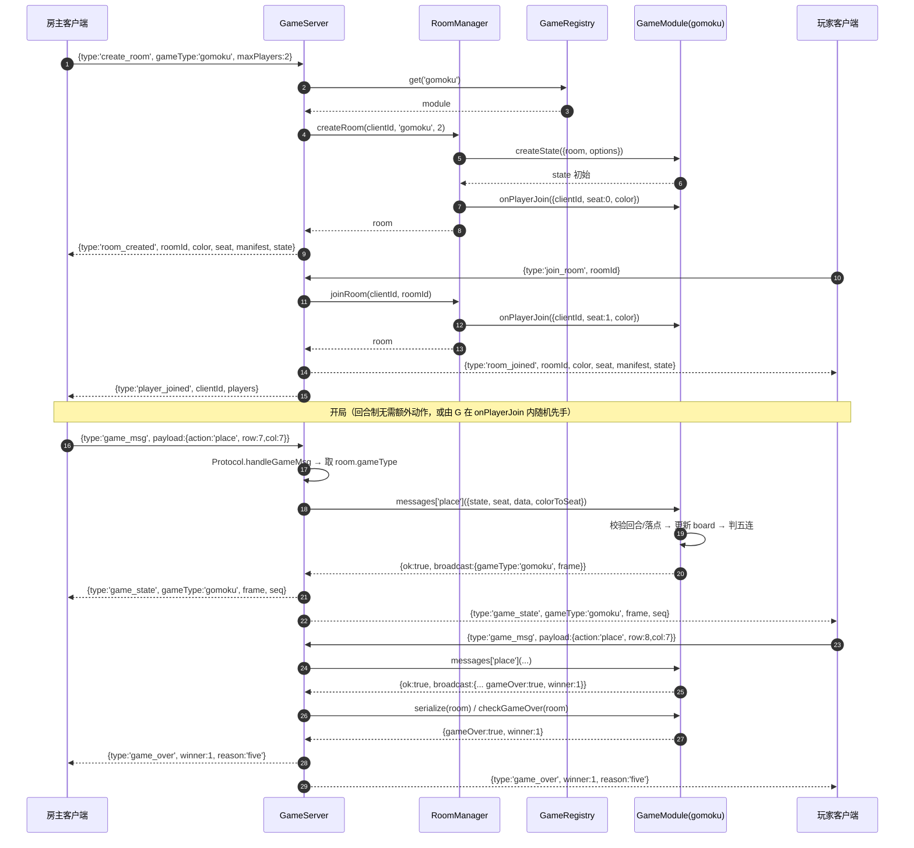

# LocalNetworkGames 系统架构设计

> 版本：v1.0 ｜ 阶段：系统架构（本阶段不写实现代码） ｜ 语言：简体中文
> 作者：高见远（系统架构师） ｜ 上游输入：`docs/planning/01-PRD.md` ｜ 状态：待评审
> 关联交付：`docs/planning/03-tasks.md`（任务分解与批次路线图）

---

## 0. 结论速览（一页纸）

| 主题 | 架构决策 |
|---|---|
| 核心矛盾 | 新增游戏需改 4~6 个核心文件 → 引入**统一游戏模块契约** + **服务端/客户端注册表分发** |
| 契约抽象 | 回合制与实时类**共用一套契约**：`tick` / `serialize` / `checkGameOver` 全部**可选**；实时类靠声明 `manifest.tickMs` 表达频率 |
| 注册机制（Q1） | 推荐**约定式目录扫描**（扫描 `games/*/manifest.json`），满足 G4「只丢一个目录」；单游戏加载失败自动降级，不影响其它游戏 |
| 通信协议 | 通用信封 `{type, gameType, roomId, seq, payload}`；**游戏自定义消息统一走 `game_msg`**，服务端按当前房间 `gameType` 路由到该游戏的 `messages` 路由表 |
| 跨端共享定义 | **单一真源 = 纯 JSON**（`platform/shared/*.json`）：服务端 `require()`、浏览器 `fetch()`（顶层 await）。零构建、零 npm、两边引同一份 |
| 端口与可用性 | 端口占用**自动递增探测**（3000→3010→OS 随机），启动打印**全部内网地址**；二维码用**内置纯 JS 实现**（vendored，无 npm） |
| 移动端 | `Pointer Events` 统一触控 + `touch-action:none`；虚拟摇杆/方向键/手势由**平台统一提供**，游戏仅声明 `manifest.controls` |
| 依赖 | **新增依赖 = 0**（继续只用 `ws`） |
| 最高风险 | **T01（服务端注册表与协议去硬编码）** 与 **T08（井字棋契约模板）** —— 必须先打通以验证契约成立 |

---

## 1. 技术方案总览

### 1.1 技术选型（延续现状，零构建）

| 层 | 技术 | 选型理由 |
|---|---|---|
| 服务端运行时 | Node.js（**CommonJS**，`type: commonjs`） | 现状即 CJS；`ws` 生态成熟 |
| 服务端唯一依赖 | `ws@^8` | 现状依赖，**不新增** |
| 服务端 HTTP | Node 内置 `http` + `fs`（静态托管 `public/`） | 现状即原生；不引入 express |
| 客户端 | 原生 ES Module（`<script type="module">` + 动态 `import()`） | **零构建硬约束**；浏览器原生支持 |
| 客户端渲染 | Canvas 2D（实时类）/ DOM（回合制棋盘） | 沿用象棋=DOM、坦克/飞行棋=Canvas 的现状 |
| 触控 | `Pointer Events` + `touch-action` | 一套代码同时覆盖鼠标/触摸/触控笔 |
| 共享定义 | 纯 `.json`（服务端 `require`，浏览器 `fetch`） | 零构建下唯一能「两边引同一份」的方案 |

> **明确不做**：Vite/Webpack/TS/打包器/任何前端 npm 依赖；账号/持久化/公网联机。

### 1.2 架构分层图



**分层职责**

| 层 | 职责 | 不该做 |
|---|---|---|
| 接入层 `index.js` | 端口探测、地址枚举、静态托管、启动日志/二维码 | 不懂任何游戏规则 |
| 核心层 `server.js + core/*` | 连接、房间、座位、大厅、广播、tick 调度、消息路由 | 不含任何 `gameType === 'x'` 分支 |
| 游戏层 `games/<id>/server.js` | 该游戏的权威状态与规则、自定义消息、胜负判定 | 不直接操作 `ws`/`WebSocket`，只返回「要广播什么」 |
| 客户端平台层 `platform/*` | 路由、通用 UI、动态加载、触控层、WS 封装 | 不含具体游戏渲染/规则 |
| 客户端游戏层 `games/<id>/client.js` | 该游戏渲染与输入翻译，只调用平台提供的 `ctx` | 不直接 `new WebSocket`、不硬编码 DOM id |

### 1.3 核心矛盾复核（已读码核实）

| 位置 | 精确位置 | 硬编码内容 |
|---|---|---|
| `src/server/server.js` | `handleMessage` L132-165 `switch(data.type)` | `move`/`tank_input`/`flying_action` 分别转 `handleMove`/`handleTankInput`/`handleFlyingAction` |
| `src/server/server.js` | `initializeGameState` L564-568 | `gameType` 三分支 → 三个 `create*State` |
| `src/server/server.js` | `updateTankRooms` L570-578 + 构造器 L38 `setInterval(...,50)` | tick 只服务坦克（20FPS）；象棋/飞行棋无 tick |
| `src/server/server.js` | `createRoom` L167-211、`joinRoom` L213-273、`handleRestart` L348-372、`leaveRoom`/`cleanupPlayerState` L424-513 | 四处按 `gameType` 分支 |
| `src/server/server.js` | `handleSurrender` L378-415 | 认输逻辑内联 `gameType==='flying'` 特判 |
| `src/server/server.js` | 广播帧类型 | 硬编码 `tank_state`/`flying_state`/`move` |
| `public/js/online/OnlineGameApp.js` | L7-9 静态 `import` 三款客户端 | 顶部静态依赖 |
| `public/js/online/OnlineGameApp.js` | `enterGame` L177-218（`gameType` switch）、`handleServerMessage` L96-175（消息 switch） | 双 switch |
| `public/index.html` | L52-69 | 象棋/坦克/飞行棋各一套独立容器（棋盘 div + 2 canvas） |
| `public/js/main.js` | L9-39 | 写死 28 个 DOM 引用 |
| `public/css/main.css` | L315+ / L429+ / L451+ 分段 | 每款游戏独立样式；仅 L746/L767 两处断点 |

**结论**：把「游戏差异」全部下沉到 `games/<id>/` 目录，核心三层只保留通用逻辑，即可让新增游戏退化为「新增一个目录」。

---

## 2. 游戏引擎抽象层契约（最关键）

### 2.1 设计原则

1. **回合制与实时类共用一套契约**：差异通过**可选钩子**表达，而非两套接口。
   - 回合制：不实现 `tick`，`manifest.tickMs = 0`；每次落子由 `messages[action]` 处理器**即时**返回 `broadcast`。
   - 实时类：实现 `tick(room, now)`，`manifest.tickMs > 0`；输入处理器只改状态、**不即时广播**，由平台按 `tickMs` 定时调用 `tick` + `serialize` 出帧。
2. **游戏模块不碰网络层**：处理器只返回 `{ ok, broadcast?, error? }`，由平台统一序列化并 `ws.send`。
3. **平台提供 ctx 工具**，游戏不感知 `ws`、`seq`、座位编号细节。

### 2.2 服务端游戏模块契约（`games/<id>/server.js`，CommonJS）

```js
/**
 * 服务端游戏模块描述符（CommonJS）
 * 目录：games/<id>/server.js   id 必须与目录名一致
 */
module.exports = {
  /** @type {string} 游戏唯一 id（= 目录名） */
  id: "gomoku",

  /** @type {GameManifest} 静态元数据（与服务端 manifest.json 合并校验） */
  manifest: {
    name: "五子棋",
    mode: "turn",              // 'turn' | 'realtime'
    minPlayers: 2,
    maxPlayers: 2,
    controls: "tap",          // 'tap'|'dpad'|'joystick'|'swipe'|null（平台据此渲染控制层）
    icon: "⚫",               // emoji 或相对路径
    tickMs: 0,                 // realtime 必填(>0)，turn 为 0/省略
  },

  // ── 必需 ────────────────────────────────────────────────
  /**
   * 创建权威初始状态
   * @param {{ room: Room, options: { maxPlayers:number } }} ctx
   * @returns {object} state（可含 gameType 字段，供序列化参考）
   */
  createState(ctx) { return {}; },

  /**
   * 消息路由表：key = 游戏自定义 action（客户端经 game_msg 传入）
   * handler(ctx) 见 2.4
   * @type {Record<string, (ctx: MessageCtx) => HandleResult>}
   */
  messages: {
    // place: (ctx) => ({ ok: true, broadcast: {...} }),
  },

  // ── 可选钩子（缺省即视为空实现）────────────────────────
  /** 玩家加入房间（已分配 color/seat 后调用）*/
  onPlayerJoin(ctx) {},                 // ctx = { room, clientId, color, seat, state, server }
  /** 玩家离开房间（用于清理残留，语义同现有 cleanupPlayerState）*/
  onPlayerLeave(ctx) {},
  /** 玩家短暂断线/重连（A8 席位保留）*/
  onPlayerReconnect(ctx) {},
  /** 重开：返回新的（或就地重置的）state；不实现则由平台用 createState 兜底 */
  onRestart(room) { return this.createState({ room, options: { maxPlayers: room.maxPlayers } }); },
  /** 房间销毁时释放资源 */
  cleanup(room) {},

  /** 实时类专用：平台按 manifest.tickMs 定时调用 */
  tick(room, now) {},

  /**
   * 出帧：把权威状态转成给客户端的 frame
   * - turn 类：通常在消息处理器里直接 broadcast，可省略本方法
   * - realtime 类：platform 每 tick 调用一次后广播
   * @returns {object|null} null = 本 tick 不广播（省流）
   */
  serialize(room) { return null; },

  /**
   * 胜负判定钩子（可选）：平台在 tick / 消息处理后调用
   * @returns {{gameOver:boolean, winner:number|string|null}|null}
   */
  checkGameOver(room) { return null; },
};
```

**关键：回合制/实时类如何共用一套契约**

| 关注点 | 回合制（象棋式） | 实时 tick（坦克式） | 契约对应 |
|---|---|---|---|
| 帧驱动 | 无 | 固定频率 | `manifest.tickMs` + 可选 `tick()` |
| 输入响应 | 立即校验→立即广播结果 | 只写状态，等下一 tick | 处理器是否返回 `broadcast` |
| 状态帧 | 可直接复用 `move` 类事件帧 | 周期全量快照 | `serialize()` 可选 |
| 胜负 | 处理器内即算 | `tick` 内或 `checkGameOver` | `checkGameOver` 可选 |
| 无子可走/超时 | 处理器 `setTimeout` 交给平台调度器 | tick 内推进 | 平台 `schedule(delay, fn)` 工具 |

> 结论：**回合制 = 实时类的一个特例**（`tickMs=0` 时平台不调 `tick`）。一套契约即可覆盖。

### 2.3 客户端游戏模块契约（`public/js/games/<id>/client.js`，ESM）

```js
/**
 * 客户端游戏模块（原生 ES Module）
 * 目录：public/js/games/<id>/client.js
 */
export const descriptor = {
  id: "gomoku",

  /** 与服务端 manifest.json 同源；平台会把 catalog 条目传入 ctx.manifest，模块内可省略 */
  manifest: {
    name: "五子棋",
    mode: "turn",
    minPlayers: 2,
    maxPlayers: 2,
    controls: "tap",
    icon: "⚫",
    canvas: { width: 600, height: 600 }, // 声明逻辑画布尺寸；纯 DOM 棋盘可省略
  },

  /**
   * 挂载：平台已准备好 ctx（含 stageEl / canvas / 控制层 / send 等）
   * @param {MountCtx} ctx
   */
  mount(ctx) {},

  /** 收到权威状态帧（对应服务端 serialize / 即时 broadcast 的 frame）*/
  onState(frame) {},

  /** 收到轻量事件（可选；对应服务端 game_event）*/
  onEvent(event) {},

  /** 玩家列表/座位变化（可选）*/
  onPlayers(players) {},

  /** 卸载：必须移除所有监听、清空 stageEl（防止切游戏/离房内存泄漏）*/
  destroy() {},
};
```

**MountCtx（平台注入给游戏的能力集）**

| 字段 | 类型 | 说明 |
|---|---|---|
| `ctx.stage` | `HTMLElement` | 统一游戏容器 `#game-stage` |
| `ctx.canvas` / `ctx.ctx2d` | `HTMLCanvasElement` / `CanvasRenderingContext2D` | 仅当 `manifest.canvas` 声明时平台创建并做**等比响应式缩放**（逻辑坐标固定，CSS 自适应） |
| `ctx.manifest` | `GameManifest` | 由平台从 catalog 注入（单一真源） |
| `ctx.playerColor` / `ctx.seatIndex` | `string`/`number` | 本站座位信息 |
| `ctx.send(action, payload)` | `(string, object)=>void` | 封装为 `game_msg{action, ...payload}` 上行 |
| `ctx.controls.onMove(cb)` | `(cb({x,y})=>Unsub)` | 摇杆/拖动返回**归一化向量** |
| `ctx.controls.onTap(cb)` | `(cb({nx,ny})=>Unsub)` | 归一化坐标 0..1（棋盘类） |
| `ctx.controls.onDirection(cb)` | `(cb(dir)=>Unsub)` | `dir ∈ up/down/left/right`（方向键/滑动） |
| `ctx.controls.onButton(name, cb)` | `(...)=>Unsub` | 动作按钮（如 shoot） |
| `ctx.onResize(cb)` | `(cb(w,h)=>Unsub)` | 视口尺寸变化 |
| `ctx.toast(msg)` / `ctx.sound(name)` | `fn` | 通用提示/音效 |
| `ctx.players()` | `()=>Player[]` | 只读玩家列表 |

> **画布尺寸与响应式缩放、触屏控制层全部由平台统一提供**；游戏**只声明需求**（`manifest.canvas` + `manifest.controls`），不重复实现。

### 2.4 契约伪代码示例（可直接照抄结构）

#### 示例 A：回合制 —— 五子棋

**服务端** `games/gomoku/server.js`
```js
const SIZE = 15;
function serialize(state) {
  return { board: state.board, turn: state.turn, last: state.last,
           gameOver: state.gameOver, winner: state.winner };
}
function detectFive(board, v) { /* 四方向计数 ≥5 → true（略） */ return false; }

module.exports = {
  id: "gomoku",
  manifest: { name: "五子棋", mode: "turn", minPlayers: 2, maxPlayers: 2, controls: "tap", icon: "⚫" },

  createState() {
    return { board: Array.from({ length: SIZE }, () => Array(SIZE).fill(0)),
             turn: 0, last: null, gameOver: false, winner: null };
  },

  messages: {
    // 客户端：ctx.send('place', { row, col })
    place(ctx) {
      const { state, data } = ctx;
      if (state.gameOver) return { ok: false, error: "对局已结束" };
      if (ctx.seat !== state.turn) return { ok: false, error: "不是你的回合" };
      const { row, col } = data;
      if (row < 0 || row >= SIZE || col < 0 || col >= SIZE) return { ok: false, error: "越界" };
      if (state.board[row][col] !== 0) return { ok: false, error: "该点已有子" };
      state.board[row][col] = state.turn + 1;
      state.last = { row, col };
      if (detectFive(state.board, state.turn + 1)) {
        state.gameOver = true; state.winner = state.turn;
      } else {
        state.turn = 1 - state.turn;
      }
      return { ok: true, broadcast: { gameType: "gomoku", frame: serialize(state) } };
    },
  },

  checkGameOver(room) {
    const s = room.gameState;
    return s.gameOver ? { gameOver: true, winner: s.winner } : null;
  },
};
```

**客户端** `public/js/games/gomoku/client.js`
```js
let state = null, ctxRef = null, unsubTap = null;

function draw(ctx, st) { /* 用 ctx.ctx2d 画 15x15 棋盘与棋子（略） */ }

export const descriptor = {
  id: "gomoku",
  manifest: { name: "五子棋", mode: "turn", minPlayers: 2, maxPlayers: 2,
              controls: "tap", icon: "⚫", canvas: { width: 600, height: 600 } },
  mount(ctx) {
    ctxRef = ctx;
    unsubTap = ctx.controls.onTap(({ nx, ny }) => {
      const col = Math.round(nx * 14), row = Math.round(ny * 14);
      if (row < 0 || row > 14 || col < 0 || col > 14) return;
      ctx.send("place", { row, col });        // → 上行 game_msg{action:'place',...}
    });
    draw(ctx, ctx.players() && state);
  },
  onState(frame) { state = frame; draw(ctxRef, state); },
  destroy() { unsubTap && unsubTap(); ctxRef.stage.innerHTML = ""; },
};
```

#### 示例 B：实时 —— 相扑推挤

**服务端** `games/sumo/server.js`
```js
const clamp = (v, a, b) => Math.max(a, Math.min(b, v));

module.exports = {
  id: "sumo",
  manifest: { name: "相扑推挤", mode: "realtime", minPlayers: 2, maxPlayers: 4,
              controls: "joystick", icon: "🤼", tickMs: 50 },

  createState() {
    return { arena: { r: 220 }, players: {}, gameOver: false, winner: null, seq: 0 };
  },

  messages: {
    // 客户端：ctx.send('input', { vec:{x,y} })  —— 实时类只写状态，不即时广播
    input(ctx) {
      const p = ctx.state.players[ctx.clientId];
      if (!p) return { ok: true };
      p.ax = clamp(ctx.data.vec?.x || 0, -1, 1);
      p.ay = clamp(ctx.data.vec?.y || 0, -1, 1);
      return { ok: true };
    },
  },

  onPlayerJoin({ state, clientId, seat }) {
    if (state.players[clientId]) return;
    state.players[clientId] = { id: clientId, seat, x: spawnX(seat), y: spawnY(seat),
                                vx: 0, vy: 0, ax: 0, ay: 0, in: true };
  },
  onPlayerLeave({ state, clientId }) { delete state.players[clientId]; },

  tick(room, now) {                              // 平台每 50ms 调一次
    const s = room.gameState;
    if (s.gameOver) return;
    const dt = 1 / 20;
    for (const p of Object.values(s.players)) {
      p.vx += p.ax * 400 * dt; p.vy += p.ay * 400 * dt;
      p.vx *= 0.9; p.vy *= 0.9;
      p.x += p.vx * dt; p.y += p.vy * dt;
      p.in = Math.hypot(p.x, p.y) <= s.arena.r;   // 出圈判负
    }
    resolvePush(s);                                // 玩家相互推挤（略）
    const list = Object.values(s.players);
    const alive = list.filter(p => p.in);
    if (list.length >= 2 && alive.length <= 1) {
      s.gameOver = true; s.winner = alive[0]?.seat ?? null;
    }
  },

  serialize(room) {                               // 每 tick 出帧（状态小，用全量）
    const s = room.gameState;
    return { gameType: "sumo", players: s.players, arena: s.arena,
             gameOver: s.gameOver, winner: s.winner };
  },
};
```

**客户端** `public/js/games/sumo/client.js`
```js
let st = null, ctxRef = null, unsubMove = null;

function render(ctx, state) { /* 用 ctx.ctx2d 画圈与角色（略） */ }

export const descriptor = {
  id: "sumo",
  manifest: { name: "相扑推挤", mode: "realtime", minPlayers: 2, maxPlayers: 4,
              controls: "joystick", icon: "🤼", canvas: { width: 600, height: 600 } },
  mount(ctx) {
    ctxRef = ctx;
    // 平台把摇杆/方向键归一为向量；游戏只做“翻译 + 上行”
    unsubMove = ctx.controls.onMove(({ x, y }) => ctx.send("input", { vec: { x, y } }));
  },
  onState(frame) { st = frame; render(ctxRef, st); },
  destroy() { unsubMove && unsubMove(); },
};
```

> 两个示例对照可见：**回合制不实现 `tick`/`serialize`（改为处理器内直接 `broadcast`）；实时类实现 `tick`+`serialize`，输入处理器不广播**——差异仅由可选钩子表达，平台分发逻辑完全一致。

---

## 3. 游戏注册与加载机制（回答 Q1）

### 3.1 推荐：约定式目录扫描 + `manifest.json`（单一真源）

**理由（一句话）**：G4 要求「新增游戏只新增一个目录、核心文件零改动」，只有目录扫描能做到真正的零改核心；用 `manifest.json` 提前声明元数据，避免为渲染大厅而加载全部游戏代码，兼顾了「零改核心」与「加载有序可控」。

**目录约定**

```
games/
  <id>/
    manifest.json     # 纯 JSON 元数据（服务端扫描 & 客户端目录来源）
    server.js         # 服务端权威逻辑（CommonJS）
    client.js         # 客户端渲染/输入（ESM，平台按需动态 import）
```

**加载顺序（服务端启动）**



**错误降级（关键）**：单个游戏目录读取/`require`/校验失败，仅 `console.warn` 并跳过，其余游戏正常注册；`GET /api/catalog` 只返回成功注册的游戏。**保证「某游戏加载失败不影响其他游戏」**。

**客户端加载顺序**



**权衡与备选**

| 方案 | 优点 | 缺点 | 结论 |
|---|---|---|---|
| **约定式目录扫描（推荐）** | 真·新增即生效；G4 达成 | 启动要做扫描/校验；错误更隐蔽（靠日志） | ✅ 采用 |
| 显式注册表（`games/index.js` 手列） | 直观、可读、错误显式 | 新增游戏需改 1 处核心 → 违背 G4「零改核心」 | ❌ 备选（若团队更看重可控性） |

> 折中：目录扫描为**主**，另提供 `games/registry.lock.json`（由扫描结果生成，仅用于**只读校验告警**，非必需）。若某游戏被停用，可在其 `manifest.json` 写 `"enabled": false`。

---

## 4. 通用化 WebSocket 协议设计

### 4.1 通用信封

```jsonc
{
  "type": "game_msg",          // 平台消息类型
  "gameType": "gomoku",        // 相关游戏（平台消息可省略）
  "roomId": "room_AB12CD",     // 相关房间（可省略）
  "seq": 128,                  // 单调递增序号（服务端出帧用，便于丢包/顺序诊断）
  "payload": { "action": "place", "row": 7, "col": 7 }
}
```

- **兼容性**：新增可选字段，旧代码忽略未知字段；`seq` 仅服务端下行递增，客户端可忽略。
- **上行**：客户端消息 `payload` 内放业务字段；`game_msg` 的 `payload.action` 决定路由。

### 4.2 平台级消息清单

**上行（客户端 → 服务端）** —— 目标 10 类

| type | payload | 说明 | 对应现状 |
|---|---|---|---|
| `create_room` | `{gameType, maxPlayers, options?}` | 建房 | ✅ 同 |
| `join_room` | `{roomId}` | 加入 | ✅ 同 |
| `leave_room` | `{}` | 主动离房（回大厅/换游戏） | 🆕（现仅靠断线） |
| `get_rooms` | `{gameType?}` | 房间列表（可按游戏过滤） | ✅ 同 + 增过滤 |
| `get_catalog` | `{}` | 拉游戏目录 | 🆕 |
| `chat` | `{message}` | 聊天 | ✅ 同 |
| `restart` | `{}` | 重开 | ✅ 同 |
| `surrender` | `{}` | 认输 | ✅ 同 |
| `game_msg` | `{action, ...args}` | **游戏自定义消息统一入口** | 🔁 取代 `move`/`tank_input`/`flying_action` |
| `reconnect` | `{clientId, roomId}` | 断线重连 | 🆕（A8） |

**下行（服务端 → 客户端）** —— 目标 13 类

| type | payload | 说明 | 对应现状 |
|---|---|---|---|
| `welcome` | `{clientId, catalog?}` | 连接成功 | ✅ 同 |
| `catalog` | `{games:[Manifest]}` | 游戏目录（也可走 HTTP） | 🆕 |
| `room_created` | `{roomId, gameType, color, seat, maxPlayers, state, manifest, players}` | 建房成功 | ✅ 同 + 增 seat/manifest/players |
| `room_joined` | `{roomId, gameType, color, seat, maxPlayers, state, manifest, players, opponent}` | 加入成功 | ✅ 同 + 增 seat/manifest/players |
| `room_list` | `{rooms}` | 房间列表 | ✅ 同 |
| `player_joined` | `{clientId, players}` | 有人加入 | ✅ 同 + 增 players |
| `player_left` | `{clientId, players}` | 有人离开 | ✅ 同 + 增 players |
| `chat` | `{clientId, message, timestamp}` | 聊天 | ✅ 同 |
| `game_state` | `{gameType, frame, seq}` | **权威状态帧（统一）** | 🔁 取代 `move`/`tank_state`/`flying_state` |
| `game_event` | `{gameType, event}` | 轻量事件（吃子/将军/骰子/提示） | 🆕（可选，减少全量帧） |
| `game_over` | `{gameType, winner, reason, message}` | 对局结束 | ✅ 同 |
| `game_restarted` | `{roomId, gameType, state}` | 重开完成 | ✅ 同 |
| `seat` | `{color, seat, players}` | 座位/玩家变化 | 🆕（A8 重连恢复时用） |
| `error` | `{message, code?}` | 错误 | ✅ 同 |

### 4.3 游戏自定义消息的透传方式

- **统一走 `game_msg`**（上行）+ `game_state` / `game_event`（下行），**不按 `gameType` 前缀分消息名**。
- 服务端路由：`Protocol.handleGameMsg(clientId, payload)` → 取 `client.roomId` 对应房间 → `registry.get(room.gameType).messages[payload.action](ctx)`。
- 好处：`handleMessage` 的 `switch` 变成**平台固定 10 条**，永不因新增游戏而改动；游戏 action 命名空间天然隔离在各自 `messages` 表内。
- 兼容现状：`chess` 的 `move`、`tank` 的 `tank_input`、`flying` 的 `flying_action` 全部收编为 action：
  - `move` → `game_msg{action:'move', from, to}`
  - `tank_input` → `game_msg{action:'input', keys}`
  - `flying_action` → `game_msg{action: data.action, pieceIndex?}`

### 4.4 兼容迁移映射表（旧 → 新）

**上行**

| 旧 type | 新信封 | payload 变化 |
|---|---|---|
| `move` | `game_msg` | `{action:'move', from, to}`（`piece` 可省略，服务端权威读取） |
| `tank_input` | `game_msg` | `{action:'input', keys}` |
| `flying_action` | `game_msg` | `{action:'roll'}` / `{action:'move', pieceIndex}` |
| `create_room`/`join_room`/`get_rooms`/`chat`/`restart`/`surrender` | 同名保留 | 不变（`get_rooms` 增 `gameType` 过滤可选） |

**下行**

| 旧 type | 新信封 | 变化 |
|---|---|---|
| `move` | `game_state` (gameType=chess) | `frame` = 原 `move` payload 去掉 `type` |
| `tank_state` | `game_state` (gameType=tank) | `frame` = 原 payload（`players/bullets/obstacles/gameOver/winner`） |
| `flying_state` | `game_state` (gameType=flying) | `frame` = `{ state }`（保留原文以最小改动客户端） |
| `room_created`/`room_joined` | 同名保留 | 增 `seat`/`manifest`/`players` |
| `player_joined`/`player_left` | 同名保留 | 增 `players` |
| `game_restarted`/`game_over`/`error`/`welcome`/`room_list`/`chat` | 同名保留 | 基本不变 |
| — | `catalog` / `seat` / `game_event` | 新增 |

> **不破坏现有三款游戏**：客户端与服务端由同一台服务器分发，**同版本一起升级**，因此可安全迁移帧类型；三款游戏的行为（回合校验、吃子、判胜、补广播）在 §9 回归底线中逐条锁定。

---

## 5. 目录结构（目标形态）

> 图例：🆕新增 ｜ ♻️改造 ｜ ✅保持不变

```
LocalNetworkGames/
├─ server.js                     ✅  兼容入口（require ./src/server/index）
├─ start.bat                     ♻️  改为 node src/server/index.js 并保留 pause
├─ package.json                  ✅  仅 ws，scripts.start 不变
│
├─ platform/
│  └─ shared/                    🆕  跨端共享定义（单一真源，纯 JSON）
│     ├─ message-types.json          上行/下行 type 常量
│     ├─ controls.json               控制方式枚举 tap/dpad/joystick/swipe
│     └─ colors.json                 颜色/座位映射
│
├─ games/                        🆕  游戏清单根（服务端扫描 + 客户端目录）
│  ├─ chess/    manifest.json 🆕 · server.js ♻️ · client.js ♻️
│  ├─ tank/     manifest.json 🆕 · server.js ♻️ · client.js ♻️
│  ├─ flying/   manifest.json 🆕 · server.js ♻️ · client.js ♻️
│  ├─ tictactoe/ 新增（契约模板，最先打通）
│  ├─ gomoku/    新增（B1）
│  ├─ snake/     新增（B2）
│  └─ sumo/      新增（B6）
│
├─ src/server/
│  ├─ index.js                   ♻️  端口探测 + 地址枚举 + 二维码 + 启动
│  ├─ server.js                  ♻️  GameServer：通用 HTTP/WS/大厅/广播
│  ├─ core/                      🆕  平台核心
│  │  ├─ GameRegistry.js              扫描/注册/降级/契约校验
│  │  ├─ RoomManager.js               房间/座位/重连席位/tick 调度
│  │  ├─ Protocol.js                  信封构造 + 平台消息路由骨架
│  │  └─ addresses.js                 os.networkInterfaces 枚举 + 端口探测
│  └─ games/                     ♻️  迁移至 games/ 后此目录删除（或留作兼容 shim）
│
├─ public/
│  ├─ index.html                 ♻️  单一 #game-stage + 通用 Header/侧栏/Tab
│  ├─ css/
│  │  ├─ base.css                🆕  从 main.css 抽出的通用样式（变量/按钮/布局）
│  │  ├─ platform.css            🆕  大厅/房间页/控制层/移动端断点
│  │  └─ main.css                ♻️  仅保留兼容，逐步让位 base/platform
│  └─ js/
│     ├─ main.js                 ♻️  极简 bootstrap（fetch catalog → new App）
│     ├─ platform/               🆕
│     │  ├─ App.js                   大厅↔房间 路由与状态
│     │  ├─ Lobby.js                 游戏目录 + 房间列表
│     │  ├─ RoomScreen.js            通用房间页
│     │  ├─ GameHost.js              动态 import + 生命周期
│     │  ├─ Controls.js              虚拟摇杆/dpad/swipe/tap 统一层
│     │  ├─ Net.js                   WS 封装 + seq + 重连
│     │  └─ shared.js                读取 platform/shared/*.json
│     ├─ vendor/
│     │  └─ qrcode.js            🆕  内置纯 JS 二维码（无 npm，附 License）
│     └─ games/
│        ├─ chess/  client.js ♻️ · ChessRulesClient.js ✅（保留，供提示）
│        ├─ tank/   client.js ♻️
│        ├─ flying/ client.js ♻️
│        └─ 新游戏/<id>/client.js 🆕
│
└─ docs/planning/                02-architecture.md · 03-tasks.md
```

**说明**：把服务端游戏逻辑从 `src/server/games/*` 迁移到统一根 `games/*`，是为了让「一个游戏 = 一个目录 = 三件套」成立；迁移是机械移动 + 改 `require` 路径。若团队希望**零移动**，备选方案见 §12 风险 R9。

---

## 6. 关键类图与调用时序图

### 6.1 类图（服务端 + 契约）

```mermaid
classDiagram
  class GameServer {
    +http.Server server
    +WebSocket.Server wss
    +Map~string,Client~ clients
    +RoomManager rooms
    +GameRegistry registry
    +handleHttpRequest(req,res)
    +setupWebSocket()
    +handleMessage(clientId, data)
    +onConnect(ws)
    +onDisconnect(clientId)
    +sendTo(clientId, msg)
    +broadcast(roomId, msg, excludeId)
  }

  class GameRegistry {
    -Map~string,GameModule~ modules
    -Array~Manifest~ catalog
    +scan(rootDir)
    +validate(module, manifest) bool
    +get(id) GameModule
    +list() Manifest[]
  }

  class RoomManager {
    -Map~string,Room~ rooms
    -Map~string,timer~ tickTimers
    +createRoom(clientId, gameType, maxPlayers) Room
    +joinRoom(clientId, roomId) Room
    +leaveRoom(clientId)
    +getRoom(roomId) Room
    +scheduleTick(room)
    +tickAll(now)
    +listRooms(gameType) RoomInfo[]
    +reserveSeat(clientId, roomId)
  }

  class Protocol {
    +makeEnvelope(type, {gameType, roomId, payload, seq}) object
    +handleGameMsg(server, clientId, payload)
    +routePlatformMsg(server, clientId, envelope)
  }

  class Room {
    +string id
    +string gameType
    +Set~string~ clients
    +Map~string,Seat~ seats
    +object gameState
    +number maxPlayers
    +number created
    +number seq
    +boolean started
  }

  class Seat {
    +number index
    +string color
    +string clientId
    +number reservedUntil
  }

  class GameModule {
    <<interface>>
    +string id
    +Manifest manifest
    +createState(ctx) object
    +Map messages
    +onPlayerJoin(ctx)
    +onPlayerLeave(ctx)
    +onRestart(room) object
    +tick(room, now)
    +serialize(room) object
    +checkGameOver(room) Result
    +cleanup(room)
  }

  class Manifest {
    +string id
    +string name
    +string mode
    +number minPlayers
    +number maxPlayers
    +string controls
    +string icon
    +number tickMs
  }

  GameServer --> GameRegistry
  GameServer --> RoomManager
  GameServer --> Protocol
  RoomManager --> Room
  Room --> Seat
  GameRegistry --> GameModule
  GameModule --> Manifest
  Protocol --> GameRegistry
  Protocol --> RoomManager
```

### 6.2 客户端类图



### 6.3 时序图 A：创建房间 → 加入 → 开局 → 消息往返 → 结束（回合制）



### 6.4 时序图 B：实时类一帧流程（tick）

```mermaid
sequenceDiagram
  autonumber
  participant T as 平台 tick 调度器
  participant RM as RoomManager
  participant G as GameModule(sumo)
  participant S as GameServer
  participant C as 客户端们

  Note over T: 单一定时器（如 20ms），按房间 tickMs 累积门控
  T->>RM: tickAll(now)
  loop 每个 realtime 房间
    RM->>RM: acc += elapsed; if acc >= tickMs 则触发
    RM->>G: tick(room, now)
    G->>G: 积分位移 → 碰撞/推挤 → 出圈判定 → 胜负判定
    RM->>G: serialize(room)
    G-->>RM: frame（或 null=不广播）
    alt frame != null
      RM->>S: broadcast(room.id, {type:'game_state', gameType, frame, seq++})
      S-->>C: 权威状态帧（同一 JSON 串广播给全房）
    end
  end

  Note over C: 客户端输入（摇杆）
  C->>S: {type:'game_msg', payload:{action:'input', vec:{x,y}}}
  S->>G: messages['input'](...)  只写状态，不即时广播
```

---

## 7. 移动端与触屏方案

### 7.1 响应式断点策略

| 断点 | 布局 |
|---|---|
| ≥1024px（桌面） | 主区居中，右侧信息栏常驻（玩家/聊天/操作） |
| 768–1023px（平板/横屏手机） | 左主区 + 右信息栏；实时游戏触控层叠于主区左右下角 |
| 414–767px（手机横屏） | 主区占满高度，信息区收为可折叠侧栏 |
| ≤413px（手机竖屏，375 基准） | 主区置顶满宽；信息区收为**底部 Tab**（玩家/聊天/操作）；实时游戏显示「建议横屏」提示（非强制） |

### 7.2 viewport / touch-action

```html
<meta name="viewport"
      content="width=device-width, initial-scale=1.0, maximum-scale=1.0, user-scalable=no, viewport-fit=cover" />
```
```css
#game-stage, .touch-layer, .joystick { touch-action: none; }   /* 禁双击缩放+误滚动 */
body { overscroll-behavior: none; }
.stage-canvas { width: 100%; height: auto; display: block; }   /* 逻辑坐标固定，CSS 等比缩放 */
```

- **Pointer Events 统一**：所有输入用 `pointerdown/pointermove/pointerup` + `setPointerCapture(pointerId)`；以 `pointerId` 跟踪多点（摇杆 + 射击键可同时按）。
- 命中坐标换算沿用现状思路（`getBoundingClientRect` + 缩放比），由平台在 `Controls.js` 内统一处理，游戏拿到的是**归一化坐标**。

### 7.3 虚拟控制层（平台统一提供）

| `manifest.controls` | 平台渲染 | 输出回调 | 适用 |
|---|---|---|---|
| `'joystick'` | 左下虚拟摇杆（base+knob，DOM+Canvas 均可） + 右下动作键 | `onMove({x,y})` / `onButton('shoot', …)` | 坦克、飞机 |
| `'dpad'` | 左下四方向键 | `onDirection(dir)` | 贪吃蛇、相扑（可选） |
| `'swipe'` | 主区手势 | `onDirection(dir)` | 贪吃蛇、相扑（可选） |
| `'tap'` | 无专用层，主区点击 | `onTap({nx,ny})` | 回合制棋盘 |
| `null` | 无 | 游戏自管（如 Pong 拖动横条，走 `onMove` 一维） | 特殊 |

**虚拟摇杆实现要点（纯原生，无依赖）**
1. 容器 `position:absolute; left:0; bottom:0`，尺寸随断点 `clamp(96px, 24vw, 160px)`。
2. `pointerdown` 记录中心，`pointermove` 计算向量并 `clamp` 半径 → `knob.style.transform = translate(x,y)`。
3. 归一化向量 `(|v|>deadZone)` 才输出；`pointerup` 归零。
4. 多点：用 `pointerId` 区分摇杆与按钮；`touch-action:none` 防浏览器手势抢占。
5. **横屏建议**：实时类在竖屏时顶部显示非阻塞提示条（可关闭）。

---

## 8. 启动与可用性改造

### 8.1 端口自动探测

```mermaid
flowchart TD
  A[启动 index.js] --> B{尝试 listen(3000)}
  B -- 成功 --> Z[打印地址]
  B -- EADDRINUSE --> C[试 3001..3010]
  C -- 成功 --> Z
  C -- 全部占用 --> D[listen 0 → OS 随机空闲端口]
  D -- 成功 --> Z
  D -- 失败 --> E[打印错误并以非 0 退出]
  Z --> F[os.networkInterfaces 枚举内网 IPv4]
  F --> G[打印所有 http://ip:port + 二维码]
```

- 通过监听 `server.on('error')` 捕获 `EADDRINUSE` 后**递增端口重试**（而非直接崩溃），彻底解决现状「3000 被占用即 `EADDRINUSE` 退场」。
- 支持 `PORT` 环境变量优先；探测顺序：`PORT` → 3000..3010 → 随机。

### 8.2 内网地址枚举

```js
const os = require("os");
const nets = os.networkInterfaces();   // 遍历，过滤 family==='IPv4' && !internal
// 输出形如：
//   本机:   http://localhost:3000
//   局域网: http://192.168.1.20:3000   (WLAN / 以太网)
//   局域网: http://10.0.0.5:3000       (VPN / WSL / Docker — 标注适配器名)
```
- 保留适配器名（`WLAN`/`Ethernet`/`vEthernet`）帮助用户识别该发哪个地址。
- 过滤 `127.0.0.1`、`::1`；对虚拟网卡（WSL/Docker/VPN）**标注但不隐藏**。

### 8.3 二维码（零依赖）

| 方案 | 说明 | 采用 |
|---|---|---|
| A. 内置纯 JS 二维码编码器（vendored） | 浏览器侧渲染二维码（房主页/房间页展示），源码入库，附 MIT License | ✅ **主方案** |
| B. 终端 ASCII 二维码 | 同算法移植到 CJS，在终端打印 | 🔸 可选（P2） |
| C. 引第三方 npm 包（如 `qrcode`） | 违背「仅 ws」约束 | ❌ 否决 |

- **理由**：Node 内置无二维码能力；G6 要求零外网依赖，故必须**离线**。将一份纯 JS 二维码编码实现（单文件）放入 `public/js/vendor/qrcode.js`，浏览器端渲染（房主电脑打开页面即可展示给手机扫）。**不新增 npm 依赖**。
- 二维码内容：`http://<ip>:<port>/?room=<roomId>`（一键入房链接）。

---

## 9. 性能与容量约束

| 项 | 设计 | 说明 |
|---|---|---|
| tick 频率 | 每游戏 `manifest.tickMs`（坦克 50ms=20FPS，可提至 33ms=30FPS） | 单游戏可调，不影响他人 |
| 调度器 | **单一 `setInterval(20ms)` + 每房累积门控** | 避免「每房一个定时器」；现状是全局一个坦克定时器，延续并通用化 |
| 状态帧 | 默认**全量快照**；`serialize()` 可返回 `null` 跳过；大状态游戏（子弹多）改增量 | 坦克帧 ≈ 数 KB/帧，20FPS 局域网无压力 |
| 序列化优化 | 每帧 `JSON.stringify` **一次**，复用同一字符串广播全房 | 现状 `broadcastToRoom` 逐客户端 stringify，需优化为一次 |
| 房间列表 | 仅在房间增删/人数变化时重算并广播；缓存字符串 | 现状每次进房都全量广播 |
| 容量假设 | 单机 ≥ **10 房 / ≥40 并发**；单房 ≤ 4 人 | 用于验收压测口径（待 Q7 确认） |
| 心跳 | `ws` 层 `ping/pong`，30s 无响应判定断线 | 支撑 A8 重连判定 |

---

## 10. 风险清单

| # | 风险 | 影响 | 缓解 |
|---|---|---|---|
| R1 | 动态 `import('/js/games/<id>/client.js')` 404 被 SPA 回退成 `index.html`（200 + HTML） | 模块解析报错难排查 | 静态服务器对 `/js/**`、`/games/**`、`.js/.json` **返回 404 而非回退 index.html** |
| R2 | CommonJS 与 ESM 混用 | 服务端 `require` 客户端 ESM 会崩 | 严格隔离：服务端全 CJS；客户端全 ESM；共享定义只走 JSON |
| R3 | 客户端顶层 `await fetch(catalog)` 顺序问题 | 应用启动竞态 | `main.js` 用 `async bootstrap()` 显式 await 后再 `new App()`，不依赖顶层 await |
| R4 | `os.networkInterfaces()` 虚拟网卡噪声 | 用户发错地址 | 标注适配器名，不隐藏；默认高亮 `WLAN`/`Ethernet` |
| R5 | 首启 Windows 防火墙拦端口 | 手机连不上 | 启动日志明确提示「允许防火墙」；README 说明 |
| R6 | 定时器/监听泄漏（切游戏、离房） | 内存增长、重复 tick | 契约强制 `destroy()`/`cleanup()`；平台统一持有并释放；回归用例覆盖 |
| R7 | 二维码自研库正确性 | 扫不出 | 选成熟 vendored 实现；单元用例用已知字符串比对；附 License |
| R8 | 迁移现有三款游戏引入行为回归 | 象棋/坦克/飞行棋判胜异常 | §11「回归底线」逐条锁定 + 专项回归任务 QA |
| R9 | 迁移目录（`src/server/games/*`→`games/*`）牵动 `require` 路径 | 遗漏引用导致启动失败 | 备选：**不移动**，改为「`games/*` 仅放 manifest + client.js，server 模块按 id 约定仍从 `src/server/games/<id>/` 加载」；两方案在 T02 开工前定稿 |
| R10 | 计算型 specifier 的路径大小写（Windows 不敏感、Linux 敏感） | 部署到 Linux 报错 | 统一**小写**游戏 id；目录名与 id 严格一致（registry 校验） |

---

## 11. 回归底线（改造后现有三款游戏不能坏）

| 游戏 | 既有行为（必须保持） |
|---|---|
| 中国象棋 | 回合校验（`room.turn===color`）；走后自检防自杀棋；吃将/帅判胜；`checkmate`/`stalemate` 判负；`isCheck` 将军提示；`moveHistory` 棋谱；认输判负；重开复位（红先行）；单步非法返回 `error` |
| 坦克大战 | 20FPS tick 权威帧；WASD 移动 + J 射击；500ms 射击冷却；子弹 5 次反弹 + 障碍物碰撞；100 血、每弹 -33.4；单人练习不判胜（仅 ≥2 人判胜）；阵亡/离开置 `isAlive=false` 交由 tick 结算；重开补位 `ensureTankPlayers` |
| 飞行棋 | 2~4 人、`order` 随机；掷 6 起飞/额外行动；连续 3 次 6 本轮作废；同色格跳跃 +4；特殊跳跃点；叠子（≥2）保护不击落；起飞点/终点通道为安全区；4 子到终点判胜；无子可走 2.5s 自动过手（现为 `server.js` 内 `setTimeout`，迁入游戏模块的 `schedule`）；玩家离开清理 `order/players` 并回等待/继续 |
| 全部 | `welcome` 分配 clientId；`room_list` 全房广播；`chat` 自我过滤；`error` 弹提示；断线离开房间并广播 `player_left` |

---

## 12. 待明确事项（PRD Q1~Q8 架构侧建议）

| # | 问题 | 架构侧建议 | 是否必须用户拍板 |
|---|---|---|---|
| Q1 | 注册方式 | **约定式目录扫描**（`games/*/manifest.json`），满足 G4 零改核心 | 建议已给，**可用户确认** |
| Q2 | 第一批游戏清单 | 认可「五子棋+井字棋+贪吃蛇+相扑」；但**井字棋先行**做契约模板（体量最小）。若只保留 2 款：**井字棋（模板）+ 贪吃蛇（实时验证）** | 🔴 **必须拍板** |
| Q3 | 重连席位时长/语义 | 席位保留 **30s**（可配 20–60s）；以**持久化 `clientId`** 为标识（`localStorage`），昵称仅作**显示名**不作唯一键；保留期内他人不可占位 | 建议已给，**可用户确认** |
| Q4 | 单机/AI 对手 | 建议 **AI 放客户端**（仅单机练习，简单本地算法，不污染服务端权威模型）；服务端托管 AI 列 P2 | 🔴 **必须拍板**（影响权威模型） |
| Q5 | 是否强制横屏 / 默认操控 | 不强制横屏，给出**非阻塞横屏提示**；实时移动类默认**摇杆**、简单移动类默认**方向键**，并提供**设置开关** | 🔴 **必须拍板** |
| Q6 | 观战 / 房间密码 | 观战列 **P2**；公开/私密房间本期**不做**（P3） | 🟡 建议已给，需确认 |
| Q7 | 玩家上限/并发目标 | 建议硬指标：**单机 ≥10 房 / ≥40 并发 / 单房 ≤4 人 / tick 20FPS** | 🔴 **必须拍板** |
| Q8 | 既有规则缺口修复 | 建议**本期维持现状**，先平台化；象棋长将和棋、飞行棋跳飞阻挡列入**第三批 backlog** | 🔴 **必须拍板** |

> **需用户拍板的硬项**：Q2（范围）、Q4（AI 归属）、Q5（操控默认）、Q7（容量指标）、Q8（缺口修复）；Q1/Q3/Q6 架构侧已给明确建议，确认即可。

---

## 附：与下游任务的衔接

- 契约（§2）、协议（§4）、注册机制（§3）是 §B 任务 **T01/T02/T04/T05** 的输入；
- 井字棋契约模板 = **T08**，用于验证「只新增目录即可上线」；
- 回归底线（§11）是 QA 回归任务的验收依据；
- 完整任务清单、批次路线图、依赖图见 `docs/planning/03-tasks.md`。
