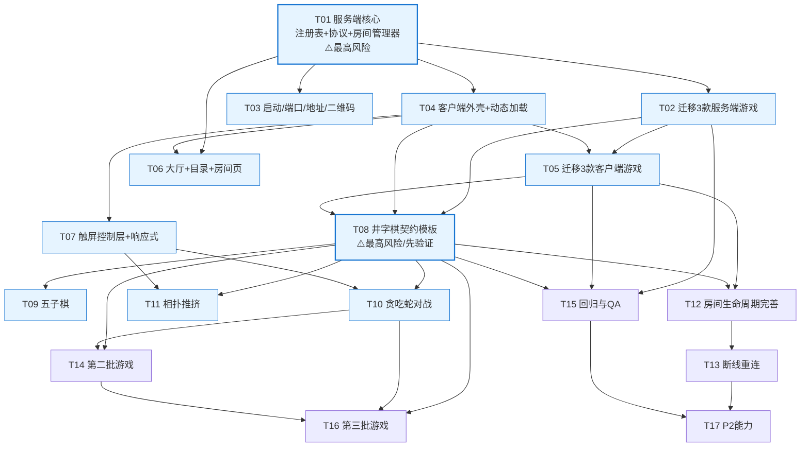

# LocalNetworkGames 任务分解清单

> 版本：v1.0 ｜ 阶段：任务分解（本阶段不写实现代码） ｜ 语言：简体中文
> 作者：高见远（系统架构师） ｜ 上游输入：`docs/planning/02-architecture.md`、`docs/planning/01-PRD.md`
> 原则：**先平台化（A 组）后规模加游戏（B 组）**；用**井字棋**作契约模板最先打通；依赖只允许 `ws`。

---

## 0. 总览

| 项 | 值 |
|---|---|
| 任务总数 | **16**（第一批 11 · 第二批 4 · 第三批 1，另含回归） |
| 分组 | **A 组 = 平台化改造（T01–T07）**；**B 组 = 新增游戏（T08–T11、T14、T16）**；C 组 = 房间完善/重连/回归（T12–T13、T15、T17） |
| 新增依赖 | **0**（继续只用 `ws@^8`） |
| 最高风险任务（须最先验证） | **T01（服务端注册表与协议去硬编码）** 与 **T08（井字棋契约模板）** |
| 角色 | 工程师（ENG）· QA |
| 规模 | S（≤1 人日）· M（≤3 人日）· L（>3 人日） |

---

## 1. 依赖包清单

| 包 | 版本 | 用途 | 变化 |
|---|---|---|---|
| `ws` | `^8.19.0` | 服务端 WebSocket | ✅ 保持 |
| （无新增） | — | 二维码/静态托管/触控全部用内置能力或 vendored 纯 JS | ✅ **新增依赖 = 0** |

> **若确有必要新增**（原则否决，仅备案）：`qrcode`（终端/服务端生成二维码）。已用**内置 vendor 纯 JS 实现**替代（`public/js/vendor/qrcode.js`，附 License），**不新增 npm 依赖**。

---

## 2. 跨文件共享约定

| 约定 | 规则 |
|---|---|
| **游戏 id 命名** | 全**小写**、短横线或单词（`chess`/`tank`/`flying`/`gomoku`/`tictactoe`/`snake`/`sumo`/`connect4`）；**必须等于目录名**（registry 启动校验，R10） |
| **游戏目录结构** | `games/<id>/{manifest.json, server.js, client.js}`（单一根） |
| **消息 `type` 命名** | 平台消息 **snake_case**（`create_room`/`game_state`/`player_joined`）；游戏自定义动作放 `game_msg.payload.action`，也用小写（`place`/`input`/`roll`/`move`），命名空间隔离在各游戏 `messages` 表内 |
| **控制方式枚举** | `'tap' \| 'dpad' \| 'joystick' \| 'swipe' \| null`（`platform/shared/controls.json`） |
| **颜色/座位** | `red/black/blue/green/yellow` 保留现状；座位 `seatIndex` 0..maxPlayers-1 由 `RoomManager` 统一分配 |
| **文件命名** | 服务端核心 `PascalCase.js`（`GameRegistry.js`）；客户端模块统一 `client.js`、平台页统一 `PascalCase.js` |

### 跨端共享定义（零构建下如何「两边引同一份」）—— 具体方案

**单一真源 = 纯 JSON 文件**，放 `platform/shared/`：

```
platform/shared/
  message-types.json    // { "up": ["create_room", ...], "down": ["welcome", ...] }
  controls.json         // { "modes": ["tap","dpad","joystick","swipe",null], ... }
  colors.json           // { "seatColors": ["red","black","blue","green"], ... }
```

| 侧 | 引用方式 | 说明 |
|---|---|---|
| 服务端（CommonJS） | `const TYPES = require('../../platform/shared/message-types.json')` | Node 原生支持 `require` JSON |
| 浏览器（ESM） | `const TYPES = await (await fetch('/platform/shared/message-types.json')).json()` | 静态服务器已托管 `platform/`（新增静态根），`main.js` 的 `async bootstrap()` 内 await |

- **不采用** UMD/`window` 挂载/双份复制：CJS 与 ESM 无法优雅共享同一 `.js`（`module` 在 ESM 未定义）；纯 JSON 是零构建下唯一干净方案。
- **动态数据**（游戏目录）走 `GET /api/catalog`（由 `GameRegistry` 扫描 `games/*/manifest.json` 生成），客户端不重复维护 manifest。

---

## 3. 任务清单（按实现顺序）

> 列：编号 ｜ 标题 ｜ 角色 ｜ 涉及文件 ｜ 前置依赖 ｜ 验收标准 ｜ 规模/优先级
> 文件前缀 `N:`=新增，`M:`=修改，`=`=保持不变

### 第一批：平台化 + 契约模板 + 4 款新游戏

#### T01 服务端核心：注册表 + 协议 + 房间管理器（去硬编码）⚠️最高风险
- **角色**：ENG ｜ **规模/优先级**：L / P0
- **涉及文件**
  - `N: platform/shared/message-types.json`、`N: platform/shared/controls.json`、`N: platform/shared/colors.json`
  - `N: src/server/core/GameRegistry.js`（扫描 `games/*`、校验契约、降级）
  - `N: src/server/core/Protocol.js`（信封构造 + 平台消息路由 + `game_msg` 分发）
  - `N: src/server/core/RoomManager.js`（房间/座位/tick 调度/列表）
  - `M: src/server/server.js`（删除 `handleMessage`/`initializeGameState`/`updateTankRooms` 等所有 `gameType` 分支，改为委托 `core/*`）
  - `N: src/server/core/` 目录
- **前置依赖**：无
- **验收标准**
  - `server.js` 内**不再出现任何 `gameType === 'x'` 分支**；`handleMessage` 只含**平台固定消息**（≤10 条）
  - `GameRegistry.scan()` 能扫描 `games/*`，某游戏目录损坏时**仅告警跳过**，其它正常
  - `GET /api/catalog` 返回已注册游戏 manifest 列表
  - tick 调度器可被任意 realtime 游戏复用（不再只服务坦克）
- **风险**：契约/协议一旦定型，后续全部模块依赖之；**建议本任务与 T08 组成最小验证闭环优先开工**。

#### T02 迁移现有三款服务端游戏到契约
- **角色**：ENG ｜ **规模/优先级**：M / P0
- **涉及文件**
  - `N: games/chess/manifest.json`、`N: games/chess/server.js`（由 `src/server/games/chess/chessGame.js` + `ChessRulesServer.js` 迁移/包壳）
  - `N: games/tank/manifest.json`、`N: games/tank/server.js`（含 `tick`/`serialize`，`tickMs:50`）
  - `N: games/flying/manifest.json`、`N: games/flying/server.js`（把 `server.js` 里 2.5s `setTimeout` 迁入游戏的 `schedule` 语义）
  - `M: src/server/games/*`（迁移完成后删除或留兼容 shim —— 见 R9）
- **前置依赖**：T01
- **验收标准**
  - 三款游戏均可被 `GameRegistry` 注册；`messages` 表分别接收 `move` / `input` / `roll|move`
  - 坦克由 `tick`+`serialize` 出帧；象棋/飞行棋 `tickMs=0` 无 tick
  - 契约校验通过（`createState`/`messages` 必需）
- **说明**：迁移方式（移动目录 vs 保留双根）在开工前定稿（架构 §10 R9）。

#### T03 启动与可用性：端口探测 + 内网地址 + 二维码
- **角色**：ENG ｜ **规模/优先级**：M / P0
- **涉及文件**
  - `M: src/server/index.js`（端口自动探测 3000→3010→随机；启动打印全部地址）
  - `N: src/server/core/addresses.js`（`os.networkInterfaces()` 枚举 + 适配器名标注）
  - `M: start.bat`（调用 `node src/server/index.js`，保留 `pause`）
  - `N: public/js/vendor/qrcode.js`（纯 JS 二维码，附 License）
  - `M: public/js/platform/Lobby.js`/`RoomScreen.js`（展示地址 + 二维码，若 T04 已就绪）
- **前置依赖**：T01
- **验收标准**
  - 3000 被占用时**不崩溃**，自动切到下一个可用端口并打印实际端口
  - 终端打印 `localhost` + **所有**内网 IPv4 地址（含适配器名）
  - 页面上能渲染出可被手机扫出的二维码（指向 `http://<ip>:<port>/?room=`）
  - **零外网请求**（二维码本地生成）

#### T04 客户端平台外壳与动态加载
- **角色**：ENG ｜ **规模/优先级**：L / P0
- **涉及文件**
  - `N: public/js/platform/App.js`（大厅↔房间 路由）
  - `N: public/js/platform/Net.js`（WS 封装 + `seq` + 消息分发）
  - `N: public/js/platform/GameHost.js`（`import('/js/games/${id}/client.js')` 动态加载 + 生命周期）
  - `N: public/js/platform/shared.js`（`fetch` `platform/shared/*.json`）
  - `M: public/js/main.js`（改为 `async bootstrap()`：fetch catalog/shared → `new App()`）
  - `M: public/index.html`（收敛为**单一 `#game-stage`** + 通用 Header/侧栏）
  - `M: src/server/server.js`（静态托管 `platform/` 与 `/api/catalog`；**`/js/**`、`/games/**`、`.js/.json` 404 不回退**，防 R1）
- **前置依赖**：T01
- **验收标准**
  - 浏览器无打包、原生 `import()` 按 `gameType` 加载对应客户端
  - 加载失败时给友好提示并回退大厅（不白屏）
  - `main.js` **不再**手写 DOM 引用表；`index.html` **不再**按游戏分容器
  - 缺失 `.js` 资源返回 404（而非 HTML）

#### T05 迁移现有三款客户端游戏到契约
- **角色**：ENG ｜ **规模/优先级**：L / P0
- **涉及文件**
  - `M: public/js/games/chess/client.js`（由 `ChessGameClient.js` 包壳为 `descriptor{mount,onState,destroy}`；`ChessRulesClient.js` 保留复用）
  - `M: public/js/games/tank/client.js`（键盘输入 → `ctx.send('input',{keys})`）
  - `M: public/js/games/flying/client.js`（点击命中 → `ctx.send('move',{pieceIndex})`；骰子动画保留）
  - `M: public/css/*`（游戏专属样式从 `main.css` 下沉，通用样式留 `base.css`）
  - `N: public/js/games/<id>/client.js`（三款统一命名）
- **前置依赖**：T04
- **验收标准**
  - 三款客户端经 `descriptor.mount(ctx)` 挂载到 `#game-stage`，`destroy()` 无残留监听
  - 不再静态 `import` 三款（改为平台动态加载）
  - 视觉/交互与现状一致（见 §5 回归底线）

#### T06 大厅与游戏目录 UI + 通用房间页
- **角色**：ENG ｜ **规模/优先级**：M / P0
- **涉及文件**
  - `N: public/js/platform/Lobby.js`（游戏卡片网格 + 房间列表按游戏过滤 + 创建房间选游戏/人数）
  - `N: public/js/platform/RoomScreen.js`（顶部栏/玩家列表/操作区/聊天/结果弹窗）
  - `N: public/css/platform.css`（大厅/房间页样式）
  - `M: public/index.html`
- **前置依赖**：T04、T01
- **验收标准**
  - 大厅从 `/api/catalog` **动态渲染**游戏卡片（图标/名称/类型/人数/控件）
  - 房间列表显示 房间号/游戏/人数 x/max/状态；可按游戏过滤
  - 创建房间可选游戏与人数

#### T07 触屏控制层与响应式
- **角色**：ENG ｜ **规模/优先级**：M / P0
- **涉及文件**
  - `N: public/js/platform/Controls.js`（虚拟摇杆 / dpad / swipe / tap 统一层，Pointer Events）
  - `M: public/css/platform.css`（断点 1024/768/414/375；`touch-action:none`；摇杆样式）
  - `M: public/index.html`（viewport `user-scalable=no`）
- **前置依赖**：T04
- **验收标准**
  - 竖屏 375px 宽可完整操作；摇杆支持多点（移动 + 射击同时）
  - 游戏区无双击缩放/误滚动
  - 控制层由 `manifest.controls` 驱动，游戏侧零重复实现
  - 实时类竖屏显示「建议横屏」非阻塞提示

#### T08 契约模板游戏：井字棋 ⚠️最高风险（先验证）
- **角色**：ENG ｜ **规模/优先级**：S / P0
- **涉及文件**
  - `N: games/tictactoe/manifest.json`（`mode:'turn'`, 2 人, `controls:'tap'`）
  - `N: games/tictactoe/server.js`（`createState`/`messages:{place}`/`checkGameOver`）
  - `N: public/js/games/tictactoe/client.js`（`mount`/`onState`/`destroy`）
  - `M: public/js/platform/Lobby.js`（无需改动，仅靠扫描自动出现卡片 —— 用于**证明 G4**）
- **前置依赖**：T01、T02、T04、T05
- **验收标准（G4 达成验证）**
  - **核心文件零改动**即可上线井字棋（`server.js`/`index.html`/`main.js`/`OnlineGameApp` 类全部不动）
  - 建房→加入→落子→判胜→重开 全链路通
  - 若此任务需改核心文件，说明契约有缺口 → **回到 T01/T04 修补契约**（这是本任务作为「验证哨兵」的意义）

#### T09 五子棋（B1）
- **角色**：ENG ｜ **规模/优先级**：S / P0
- **涉及文件**：`N: games/gomoku/{manifest.json,server.js,client.js}`
- **前置依赖**：T08
- **验收标准**：15×15 棋盘、落子/五连判胜、悔棋不做、重开复位；只新增目录即上线

#### T10 贪吃蛇对战（B2，验证实时契约）
- **角色**：ENG ｜ **规模/优先级**：M / P0
- **涉及文件**：`N: games/snake/{manifest.json,server.js,client.js}`（`manifest.tickMs>0`，`tick`+`serialize`）
- **前置依赖**：T08、T07
- **验收标准**
  - 多人同图吃食、撞身判负；服务端权威 tick；触屏方向键/滑动可用
  - **实时契约复用验证**：仅实现 `tick`/`serialize`，无需改平台 tick 调度

#### T11 相扑推挤（B6，验证实时契约第二例）
- **角色**：ENG ｜ **规模/优先级**：S / P0
- **涉及文件**：`N: games/sumo/{manifest.json,server.js,client.js}`
- **前置依赖**：T08、T07
- **验收标准**：同图推挤、出圈判负、摇杆操控；`tickMs` 与坦克可不同频共存

> **第一批出口标准**：上述 11 项完成 + 三款既有游戏回归通过（T15 首轮）。

### 第二批：房间完善 + 重连 + 第二批游戏

#### T12 房间生命周期完善（返回大厅 / 换游戏 / 离房清理契约化）
- **角色**：ENG ｜ **规模/优先级**：M / P0
- **涉及文件**
  - `M: src/server/core/RoomManager.js`（`leave_room` 处理 + 座位回收）
  - `M: src/server/core/Protocol.js`（`leave_room` 平台消息）
  - `M: public/js/platform/RoomScreen.js`（返回大厅/换游戏按钮）
  - `M: games/*/server.js`（`onPlayerLeave` 统一实现，取代 `cleanupPlayerState` 分支）
- **前置依赖**：T05、T08
- **验收标准**：局中可返回大厅重新选游戏（不重启服务器）；单人练习不误判胜负；离房清理无残留

#### T13 断线重连（grace period，A8）
- **角色**：ENG ｜ **规模/优先级**：L / P1
- **涉及文件**
  - `M: public/js/platform/Net.js`（`clientId` 持久化 `localStorage` + 自动重连）
  - `M: src/server/core/RoomManager.js`（席位保留 30s，`reservedUntil`）
  - `M: src/server/core/Protocol.js`（`reconnect` 消息）
  - `M: games/*/server.js`（`onPlayerReconnect` 钩子）
- **前置依赖**：T12
- **验收标准**：切后台/短暂断网 30s 内回来**自动恢复原席位与权威状态**；期间他人不可占位

#### T14 第二批游戏（四子棋 + 黑白棋 + Pong/打砖块 择二）
- **角色**：ENG ｜ **规模/优先级**：M / P1
- **涉及文件**：`N: games/connect4/*`、`N: games/othello/*`、`N: games/pong/*`（按选定）
- **前置依赖**：T08、T10
- **验收标准**：均在**只新增目录**前提下上线（契约稳定性二次验证）

#### T15 回归与 QA（平台 + 三款既有游戏）
- **角色**：QA ｜ **规模/优先级**：M / P0
- **涉及文件**
  - `N: docs/qa/regression-checklist.md`
  - `N: docs/qa/test-cases.md`
  - `M: package.json`（可选：`npm test` 跑冒烟脚本，零依赖）
- **前置依赖**：T02、T05、T08
- **验收标准**：§5 回归底线**逐条通过**；多设备（手机+桌面）混合联机冒烟通过

> **第二批出口标准**：房间完善 + 重连 + 至少 2 款新游戏上线，回归全绿。

### 第三批：长尾游戏 + P2 能力

#### T16 第三批游戏（跳棋/斗兽棋/国际象棋/俯视赛车/抢旗 等按需选做）
- **角色**：ENG ｜ **规模/优先级**：M–L / P2
- **涉及文件**：`N: games/<id>/*`（每款一个目录）
- **前置依赖**：T08、T10、T14
- **验收标准**：只新增目录上线；如遇契约缺口则记录并回补

#### T17 P2 能力（观战 / 单机 AI / 昵称 / 本地战绩）
- **角色**：ENG ｜ **规模/优先级**：M / P2
- **涉及文件**：`M: src/server/core/RoomManager.js`、`M: public/js/platform/*`、`N: public/js/platform/ai/*`（若选客户端 AI）
- **前置依赖**：T13、T15
- **验收标准**：按用户对 Q4/Q6 的裁决实现（AI 归属、观战是否做）

---

## 4. 任务依赖图



**关键路径**：`T01 → T04 → T08 → {T09,T10,T11}`；`T01 → T02 → T08`。T08 是汇聚点，也正因此被定为契约验证哨兵。

---

## 5. 回归底线（改造后必须保持的既有行为）

| 游戏 | 不能坏的行为 |
|---|---|
| 中国象棋 | 回合校验；走后防自杀棋；吃将/帅判胜；`checkmate`/`stalemate` 判负；将军提示 `isCheck`；棋谱 `moveHistory`；认输判负；重开复位（红先行）；非法走子返回 `error` |
| 坦克大战 | 20FPS tick 权威帧；WASD + J；500ms 射击冷却；子弹 5 次反弹 + 障碍物；100 血、每弹 -33.4；**单人练习不判胜**；阵亡/离开置 `isAlive=false` 交 tick 结算；重开 `ensureTankPlayers` 补位 |
| 飞行棋 | 2–4 人 `order` 随机；掷 6 起飞/额外行动；连续 3 次 6 作废；同色格 +4；特殊跳跃点；叠子（≥2）保护；起飞点/终点通道安全区；4 子到终点判胜；无子可走 2.5s 自动过手；离房清理 `order/players` 并回等待/继续 |
| 通用 | `welcome` 分配 clientId；`room_list` 全房广播；`chat` 自我过滤；`error` 弹提示；断线离房广播 `player_left`；房间空则销毁 |

> QA 依据：`docs/qa/regression-checklist.md`（T15 产出），逐条对照上表。

---

## 6. 需要用户拍板的关键项（阻塞项）

| # | 项 | 影响任务 | 架构侧建议 |
|---|---|---|---|
| Q2 | 第一批游戏范围 | T08–T11 | 认可四款；若砍到 2 款 → **井字棋（模板）+ 贪吃蛇（实时验证）** |
| Q4 | AI 归属 | T17 | AI 放**客户端**（单机练习），不污染服务端权威 |
| Q5 | 强制横屏？默认操控？ | T07、T10、T11 | 不强制，默认摇杆/方向键 + 开关 |
| Q7 | 容量硬指标 | T01、T10 | ≥10 房/≥40 并发/tick 20FPS |
| Q8 | 既有规则缺口是否本期修 | T02、T16 | 本期**维持现状**，列第三批 backlog |
| Q1/Q3/Q6 | 注册方式 / 重连语义 / 观战私密房 | T01、T13、T17 | 已给建议（扫描 / 30s / 观战 P2、私密房不做），确认即可 |

> **建议开工前先敲定 Q2/Q4/Q5/Q7/Q8**，其中 Q2 直接影响第一批范围与 T08 是否加做。
